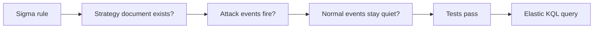

# Detection-as-Code

**Emanuel Walker, AI cybersecurity builder**
Detection Engineering · Python · Testing

## The short version

A security detection rule is software, so it should be tested like software. This project is a small pipeline that checks every rule before it ships.

A rule only counts as ready when it passes three gates:

1. **A written strategy.** Each rule has a plain document that says what it catches and why.
2. **Attack events must fire.** Made-up attack events must trigger the rule.
3. **Normal events must stay quiet.** Made-up everyday events must not trigger it.

If a rule passes, a small converter turns it from Sigma, a shared rule format, into an Elastic KQL search query.



*A rule moves left to right and stops at the first gate it fails.*

## Why it matters

A rule that misses attacks is useless. A rule that fires on normal work buries analysts in false alarms. The benign gate is there so a loud rule fails before it reaches production.

## What's in the folder

| Path | What it is |
|---|---|
| `code/rules/` | Two Sigma rules, one for credential dumping from Windows memory (LSASS) and one for PowerShell download-and-run commands. Each has a strategy document next to it. |
| `code/tests/atomic_tests/` | 12 made-up attack events, 6 per rule. Every one must fire. |
| `code/tests/benign/` | 10 made-up normal events, 5 per rule. None may fire. |
| `code/tests/test_detection_coverage.py` | The three gates, written as 6 automated tests. |
| `code/converters/sigma_to_elastic.py` | A small converter from Sigma to Elastic KQL. It is about 150 lines, so you can read it in one sitting. |
| `code/.github/workflows/detection-ci.yml` | A CI file that runs the gates on every pull request. See the note below. |
| `data/` | Two extra sample telemetry files. The tests do not use them. |
| `diagrams/detection_pipeline.drawio` | The pipeline diagram. Open it in diagrams.net. |

**CI note.** GitHub only runs workflow files from the top-level `.github` folder of a repository. This one sits inside the project, so it does not run from here. Copy it to the top of a repo that holds this project's files to use it.

## Run it

You need Python 3.10 or newer. Git is optional. You can use Code → Download ZIP instead.

macOS or Linux:

```bash
cd 01-detection-as-code
python3 -m venv .venv
source .venv/bin/activate
python -m pip install -r code/requirements.txt
pytest code/tests/ -v
```

Windows PowerShell:

```powershell
cd 01-detection-as-code
py -m venv .venv
.\.venv\Scripts\Activate.ps1
python -m pip install -r code/requirements.txt
pytest code/tests/ -v
```

You should see `6 passed`. Last checked on Nov 28, 2026: 6 passed.

Convert a rule to a KQL query:

```bash
python code/converters/sigma_to_elastic.py code/rules/suspicious_powershell_download.yml
```

It prints one Elastic KQL query. Only Elastic is supported. There is no Splunk converter.

## Try breaking it

Open `code/rules/suspicious_powershell_download.yml`. In the `condition` line, delete `and not filter_internal_artifact_server`. The rule now fires on the made-up internal software pulls too. Run the tests again. A benign test should fail. Undo the change and the tests go green again.

## What I built and why it matters

- I built a test gate that checks every detection rule against 12 attack events and 10 normal events, so a rule that is too weak or too loud fails before it ships.
- I wrote a strategy document for each of the 2 rules, and the tests fail if one is missing or empty. Every rule has a written reason to exist.

## Skills Learned and Used

| Security | Software |
|---|---|
| Detection engineering | Python and pytest |
| Sigma rules | CI/CD with GitHub Actions |
| MITRE ATT&CK mapping | YAML and JSON data |
| Elastic KQL | Technical writing |

## What this proves and what it doesn't

- **What it proves.** You can test detection rules automatically and block weak or noisy ones.
- **What it doesn't prove.** The events are made up. Two rules and 22 events are a small sample, and a pass is not a production guarantee. The converter handles only the Sigma features these two rules use.
