# Maniverse: A Self-Hosted Multi-Agent AI Lab with Zero-Trust Networking

**Emanuel Walker, AI cybersecurity builder**
Homelab · AI Security · Linux Hardening · Zero Trust

> **Status.** The home lab is built and running. The Azure cloud piece near the end is planned. It is not built yet.

## The short version

I turned a mini PC into a private home server. Three AI helpers, Claude, Codex and Muse, work together on it in a chat room I built. I can use it from my laptop or my phone.

Nothing on the server is open to the public internet. My devices reach it through Tailscale, a private encrypted network that only my own devices can join. The AI helpers can't take any action outside the room until I say yes.

On Nov 26, 2026, I had the AI helpers review the lab for security problems. I made 9 security fixes and tightened the server's settings. Then I checked everything with 219 automated tests and live checks.

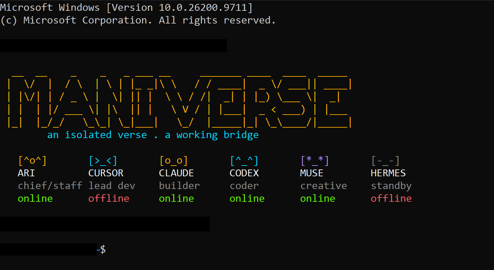

*This is what I see when I log in to the server's command line over SSH, a secure remote login.*

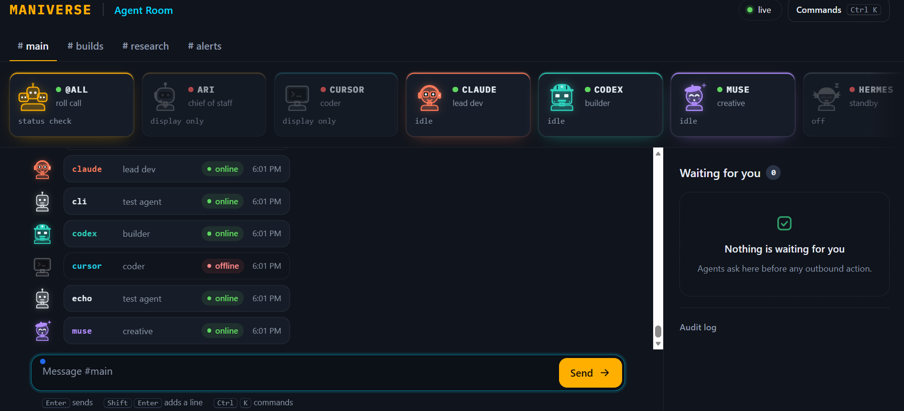

*This is the Agent Room, the private chat where my AI helpers check in and wait for my go-ahead.*

## Why I built it

AI helpers read text from many places. They also run code and touch real files. If someone slips bad instructions into that text, a helper could be tricked into doing harm. I wanted a lab where AI helpers can work together and where safety is built in at every level. Companies face the same problem when they let AI helpers do real work.

## What's in the lab

| Piece | What it is |
|---|---|
| **Home server** | A small Beelink mini PC running Ubuntu Linux. |
| **Tailscale network** | A private, encrypted network that links only my devices. No ports are open to the internet. |
| **Agent Room** | The chat room I built, where Claude, Codex and Muse work together. |
| **Phone app** | The same room, installed on my phone's home screen. |
| **agent-vault** | A private Git folder of shared notes and instructions for the AI helpers, checked automatically. |
| **Agent skills** | Reusable step-by-step guides the AI helpers follow for tasks like debugging and security review. A public set lives in [Project 2](../02-ai-agent-skills/README.md). |
| **harden.sh** | My script that locks down the server's settings. It only shows what it would change unless I tell it to apply. |

## The app I built, on my phone and my computer

I designed the Agent Room's look and feel. It is a web app made of HTML, CSS and JavaScript, about 1,900 lines in all, plus the small files that let a phone install it. AI coding helpers wrote much of the code under my direction, and I reviewed and tested it. It works the same on a big screen and a phone. It loads over a secure HTTPS address inside my private network, so my phone can install it like a real app.

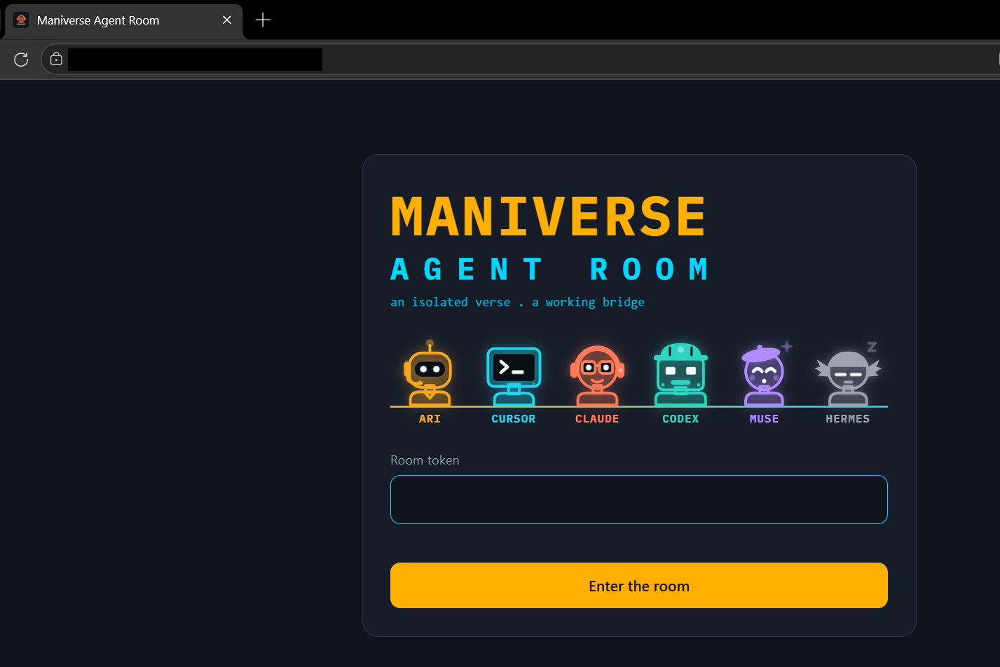

*The login screen shows a robot for each AI helper and asks for a secret room key.*

<table>
<tr>
<td width="33%" align="center">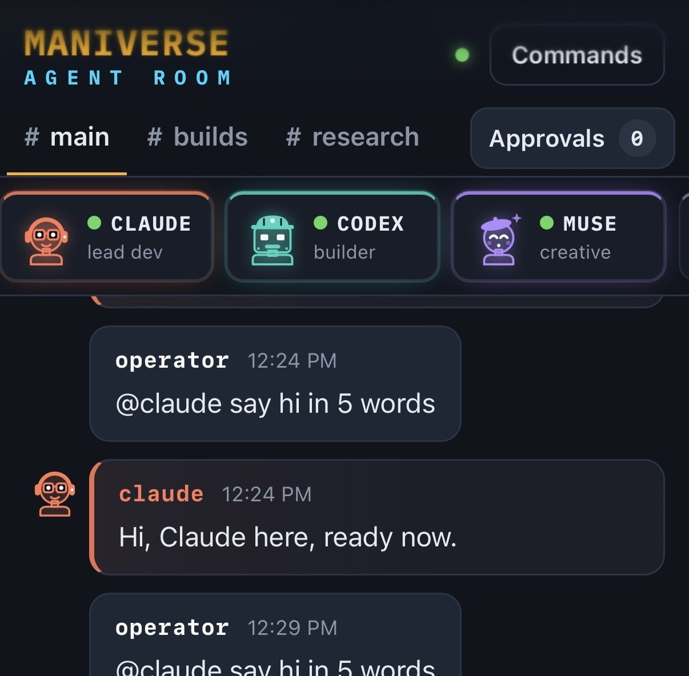 <em>On my phone, I ask Claude a question and it answers in the chat.</em></td>
<td width="33%" align="center">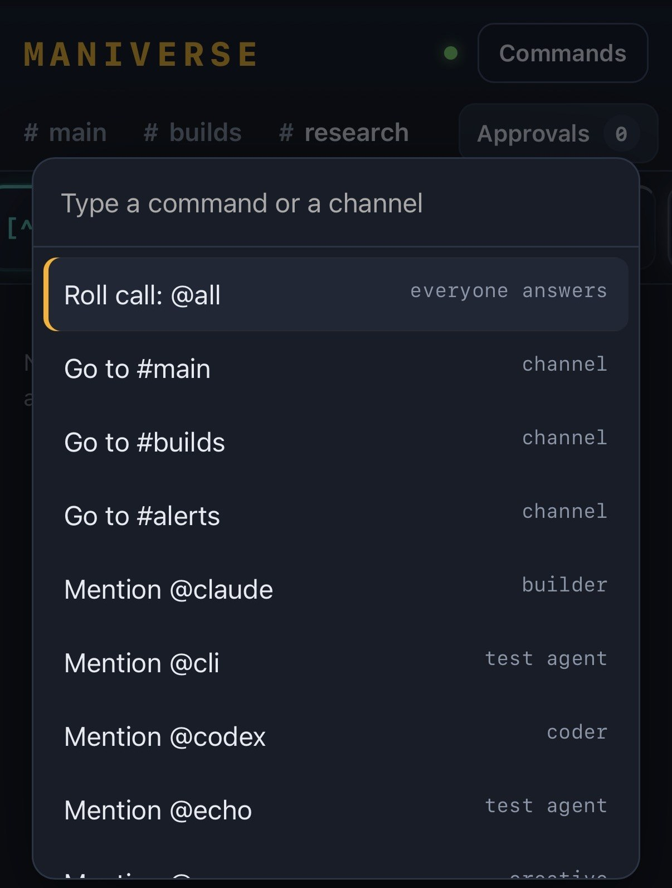 <em>A quick command menu lets me call every helper at once or jump to a channel.</em></td>
<td width="33%" align="center">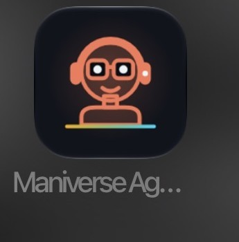 <em>The room sits on my home screen as an app with its own robot icon.</em></td>
</tr>
</table>

### The phone app

The Agent Room also runs as an app on my phone. I added it to my home screen, so it opens full screen with its own robot icon. From there I can ask the AI helpers a question, read their answers and approve or reject anything they want to do outside the room. That matters because the helpers can't act on their own, and I can give my yes or no from my pocket. Only my own devices can open it, over my private network.

<table>
<tr>
<td width="33%" align="center">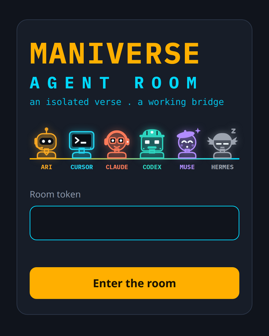 <em>The phone login asks for the room key before it shows anything.</em></td>
<td width="33%" align="center">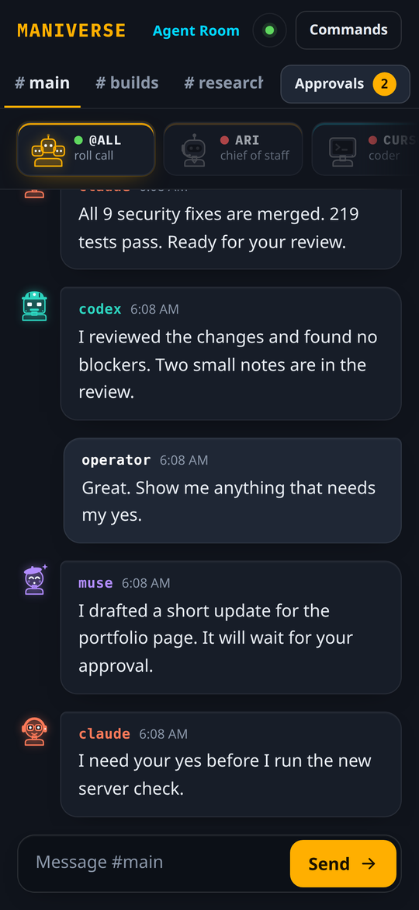 <em>The room shows each helper as a card, with their replies and a message box at the bottom.</em></td>
<td width="33%" align="center">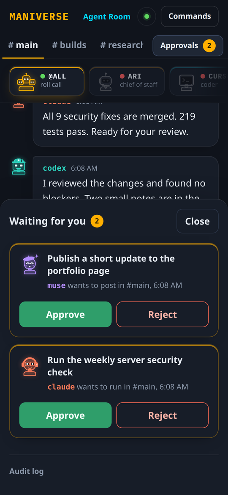 <em>The Approvals panel lists each outside action with Approve and Reject buttons.</em></td>
</tr>
</table>

*The three screens above are from a test copy of the app at phone size, running the same code with sample messages. The photos earlier in this section are from my real phone.*

## How it fits together

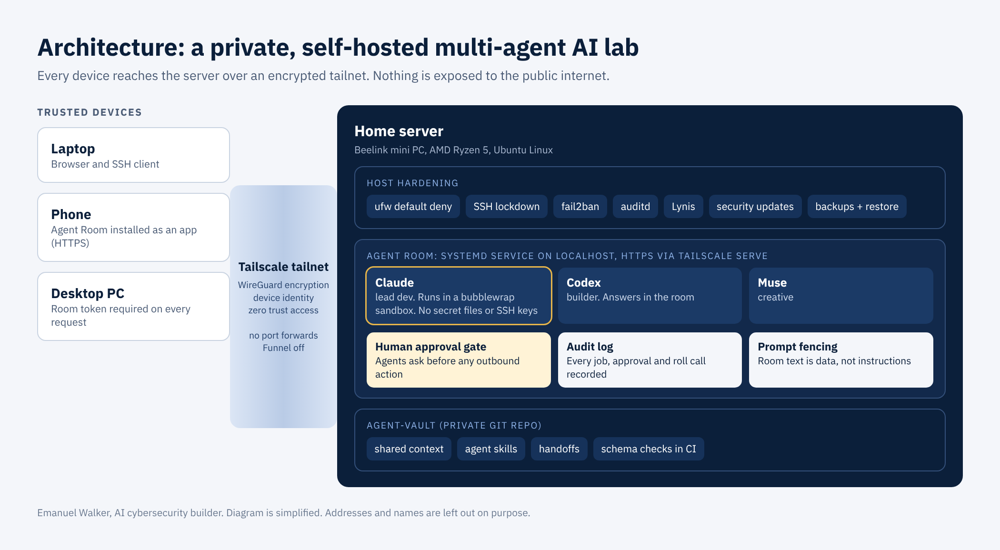

*My devices connect through the private network to one locked-down server that runs the chat room and the AI helpers.*

How one request moves through the system:

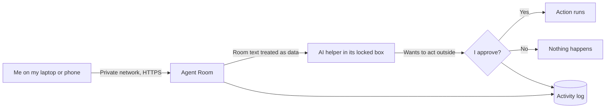

*Every outside action stops at my approval, and every decision goes into a log.*

## Keeping it private

- The server only answers devices on my Tailscale network. My home router has no open ports for it.
- The chat room only listens on the server itself. Tailscale adds a secure HTTPS address that only my devices can reach.
- A firewall blocks everything else by default.
- Every request to the room needs a secret key. Without it, the room says no.

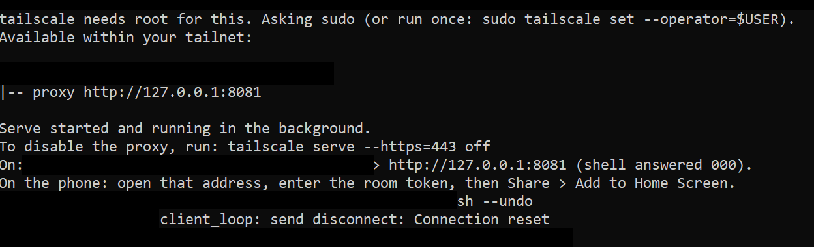

*Here I turn on a secure HTTPS address that only my own devices can reach.*

## Locking down the server

I wrote harden.sh to tighten the server's settings with free, open-source tools. Version 1 is in place. Version 2 is built and waiting for my review.

- **Blocks repeat attackers.** A tool called fail2ban bans addresses that keep failing to log in.
- **Records sensitive changes.** A tool called auditd logs changes to users, admin rights, logins and scheduled jobs.
- **Scans for weak spots.** A tool called Lynis grades the server. My first score was 56 out of 100, and I plan to raise it.
- **Locks the front door.** Nobody can log in remotely as the top admin user. Password login turns off only after my key login works, so I can't lock myself out.
- **Installs security updates on its own.** It does this without surprise restarts.
- **Undoes mistakes.** It saves a backup before every change and writes a one-line restore command.

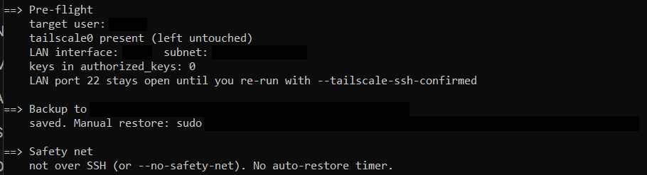

*Before it changes anything, the script checks the setup and saves a backup I can restore.*

## The security review

On Nov 26, 2026, I had AI helpers review the lab from five angles. Then I checked their work myself.

- They found 24 issues. Five were serious. None could be reached from the internet.
- The biggest risk wasn't the network anymore. It was the AI helpers themselves. A helper running under my account could read my secrets. My long-term fix is to give the helpers their own separate account.
- My rule from here on is simple. Treat everything a helper reads as untrusted, and limit what a tricked helper could reach.

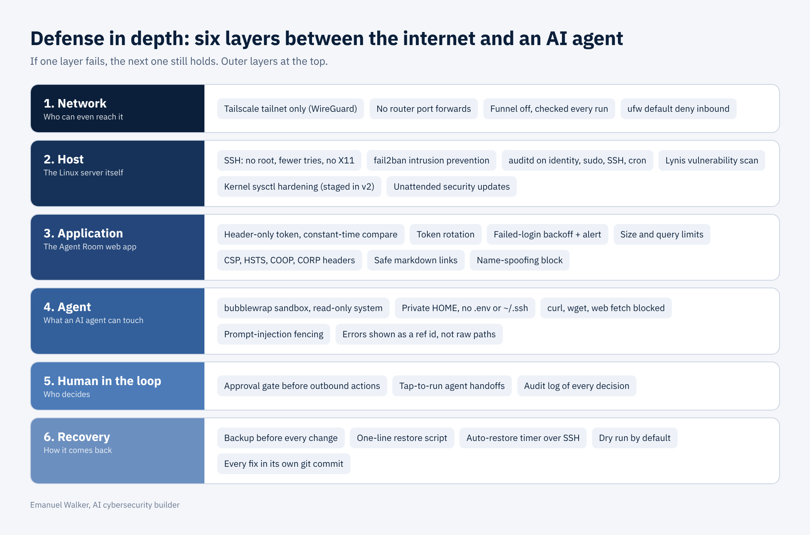

*Six layers of protection sit between the internet and each AI helper, so one failure doesn't open everything.*

## The 9 security fixes

Each fix has its own saved change and its own tests.

1. **A locked box for the coding helper.** Claude runs in a sandbox, a sealed area made with a tool called bubblewrap. It can't read my secret files or reach the web.
2. **Defense against prompt injection.** Prompt injection means hiding bad instructions in text. The room treats other messages as plain data. Only my messages count as instructions.
3. **I press Run.** One helper can suggest work for another, but nothing starts until I tap Run.
4. **Extra login options.** I built an optional approval PIN and per-helper keys. I keep them off because the room is private, and I can turn them on with one setting.
5. **Safe links.** The chat blocks tricky links.
6. **Safe error messages.** Errors show a short reference number instead of private details.
7. **Slows down guessing.** Failed logins trigger a wait time and an alert.
8. **No impersonation.** Nobody can post under a helper's name, and message sizes have limits.
9. **Browser safety settings.** The room tells the browser to apply extra safety rules.

During testing, a secret key showed up in a log. I replaced the key, confirmed the old one no longer worked and changed the logs to hide secrets.

## Testing

- 219 automated tests pass. I wrote tests for each fix.
- 71 of 71 automated browser checks pass with the extra login options on, and 63 of 63 pass with them off.
- After the fixes, each helper answered a live message in about 4 to 8 seconds. The sandboxed helper confirmed it could not read my secrets.
- A server check reported 29 passes, 18 warnings and 0 failures.

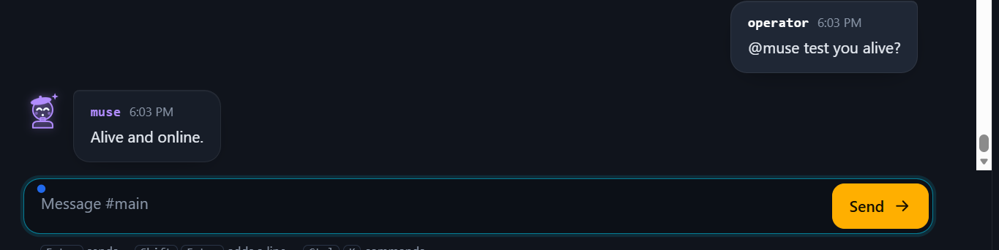

*Muse answers my test message to prove it's online after the fixes.*

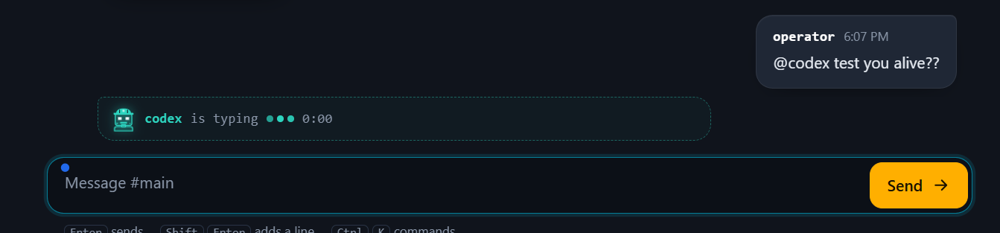

*Codex starts typing a reply to the same kind of test message.*

## What went wrong and what I learned

The first rollout failed one live check. Claude couldn't start inside its sandbox. I followed my own rule and rolled back first, and I kept the fixes saved.

The cause was one line in the server's service settings, `PrivateTmp=yes`. That line and the sandbox both try to build their own private space, and they clash. I proved it with small test setups. Then I removed the line, since the sandbox already gives Claude its own private space, and turned all 9 fixes back on. My takeaway is that two safety features can break each other. Test them together, the way they really run.

## Build timeline

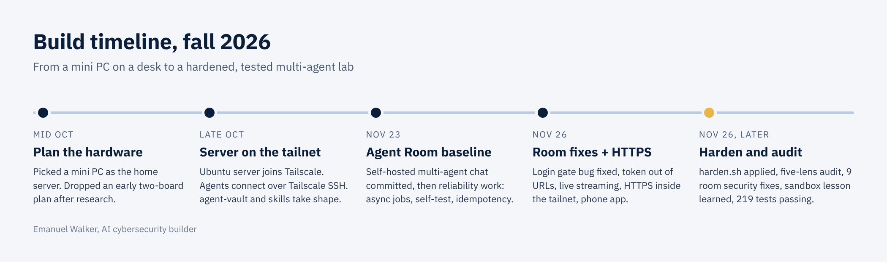

*I went from planning the hardware in mid October to a tested, locked-down lab on Nov 26.*

## What I built and why it matters

- I made 9 security fixes to my AI chat room and backed them with 219 passing automated tests, so my coding helper now runs sealed off from my secret files.
- I put 3 AI helpers in one private chat room reachable only over Tailscale, and they answer in about 4 to 8 seconds with no ports open to the internet.

## Skills Learned and Used

| Infrastructure and security | AI and software |
|---|---|
| Linux and Bash | AI agent workflows and orchestration |
| Tailscale zero-trust networking | Prompt injection defense |
| Linux hardening with systemd, fail2ban and auditd | Python and automated testing |
| Sandboxing and secure secrets handling | HTML, CSS and JavaScript web app |
| Threat modeling and security reviews | Git and GitHub |

## Next step: a cloud security lab on Azure (planned)

**Status: planned. Nothing here is built yet, and I claim no results.** I'm studying for the Microsoft AZ-900 Azure Fundamentals exam, and this lab is how I plan to practice what I learn.

The goal is to connect Maniverse to Microsoft's cloud, run safe practice attacks against my own server and catch each one with an alert.

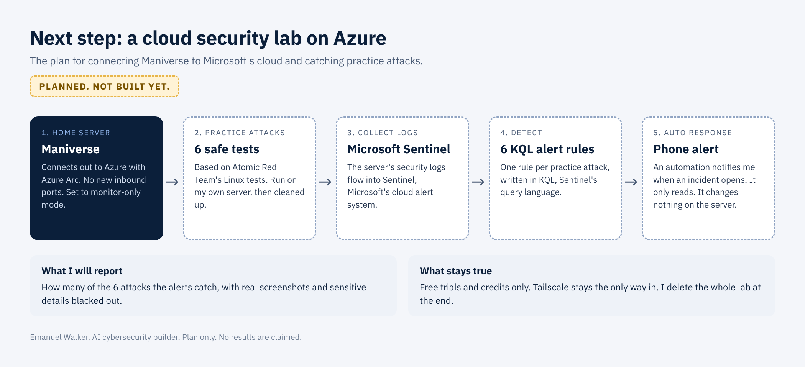

*This is the plan only: one home server, six practice attacks, six alert rules and one phone alert.*

1. **Azure Arc.** This links my home server to Azure with an outbound-only connection. I will set it to monitor-only mode, so nobody in the cloud can run commands on the server.
2. **Atomic Red Team.** This is a free library of small attack tests. I plan to run 6 safe ones from its Linux set on my own server, and clean up after each.
3. **Microsoft Sentinel.** This is Microsoft's cloud tool for collecting security logs and raising alerts.
4. **KQL.** This is Sentinel's query language. I plan to write 6 alert rules, one for each practice attack, and map them to MITRE ATT&CK.
5. **Auto response.** I plan to build one automation that sends my phone a message when an incident opens. It will only read. It won't change anything on the server.

There is one honest trade-off. A cloud link makes my Azure account part of the server's security, so I plan to turn on MFA and use a separate low-privilege lab account first. I plan to use free trials and credits only, then delete the whole lab at the end. When it is done, I will add real screenshots here and report how many of the 6 attacks the alerts caught.

## What this proves and what it doesn't

- **What it proves.** I can design, build, lock down, review and test a home AI lab, and explain the trade-offs. I build with AI coding helpers. I set the goals, review the work and test it before I trust it.
- **What it doesn't prove.** It isn't a large company system, a formal penetration test or a cloud setup. A lab result is not a guarantee for a real business.
- **Public version.** The live lab stays private. The screenshots here come from the real system with sensitive details blacked out.

## About me

M.S. Cybersecurity and Information Assurance. CompTIA Security+, CySA+ and SecurityX (CASP+).
