# Neuply: A Calm iPhone Helper for ADHD and Scattered Brains

**Emanuel Walker, AI cybersecurity builder**
iOS App · SwiftUI · Accessibility · Privacy by Design

> **Status.** Neuply is an early prototype. It runs and passes its tests in the iPhone simulator. It is not on the App Store. The AI rewrite feature is a stand-in for now, and I have not tested the app on a real iPhone yet.

## The short version

Neuply helps people with ADHD, and anyone who feels scattered, get what is in their head onto the page. You type every thought, one per line. The app sorts them into Do, Ideas, Worries and Notes. Then it picks one small next step and gives you a quiet timer to start it.

It also helps you use AI well. It writes a short "about me" file you can paste into any AI chat, so the AI knows how you like to work. Everything stays on the phone. There is no streak to lose and no guilt for taking a break.

The mascot is [Pip](../05-pip/README.md), a small seed with two leaves.

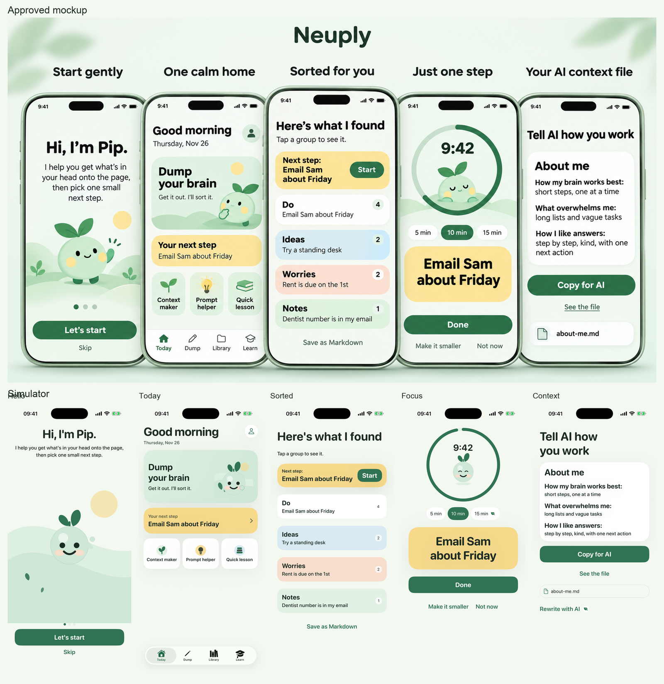

*The top row is the AI-made mockup I approved, and the bottom row is the real app running in the iPhone simulator.*

## Why I built it

Most to-do apps ask a scattered brain to organize first. That is the hard part. Neuply flips it. You dump first and sort second, and the app gives you one concrete step so you can start.

Before I built it, I studied App Store screenshots from 21 popular planner, ADHD and wellness apps. I looked for what calms people and what makes them quit. The rules I took from that were:

- One screen, one decision.
- Kind words, never guilt.
- No streaks, points or red overdue marks.
- Soft colors, big tap targets and little motion.

## The app

<table>
<tr>
<td width="33%" align="center">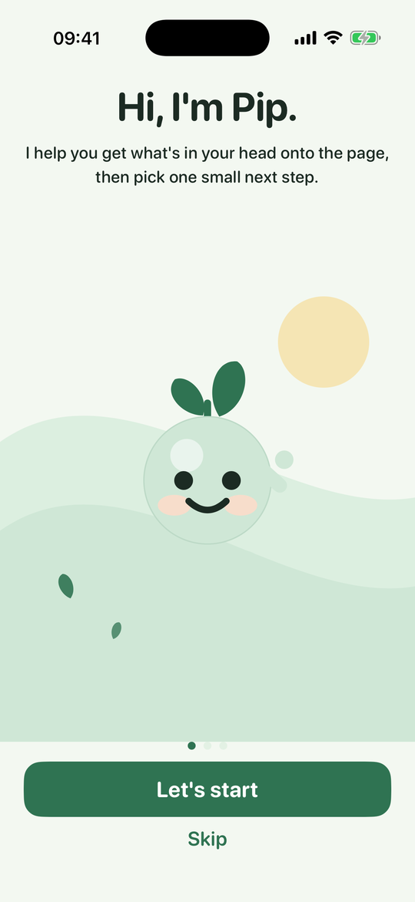 <em>Pip says hello on the first screen and invites you to start.</em></td>
<td width="33%" align="center">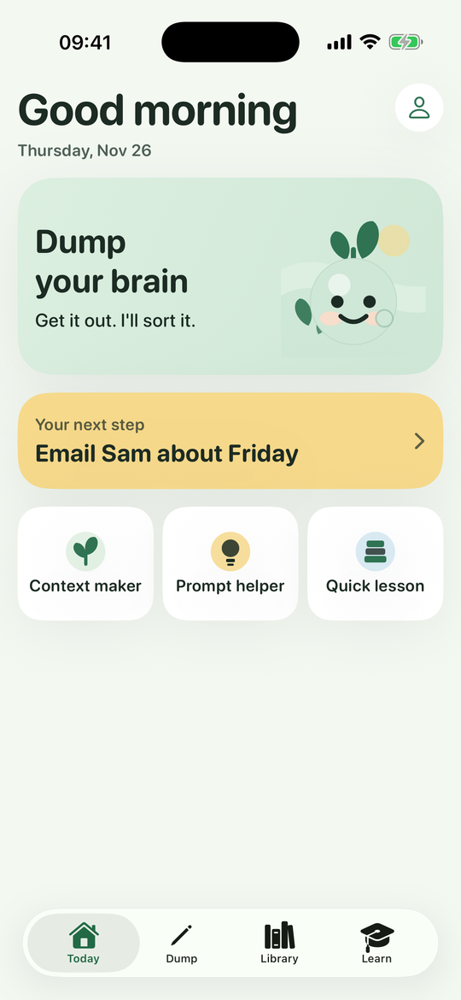 <em>The Today screen shows one card to start a brain dump and one small next step.</em></td>
<td width="33%" align="center">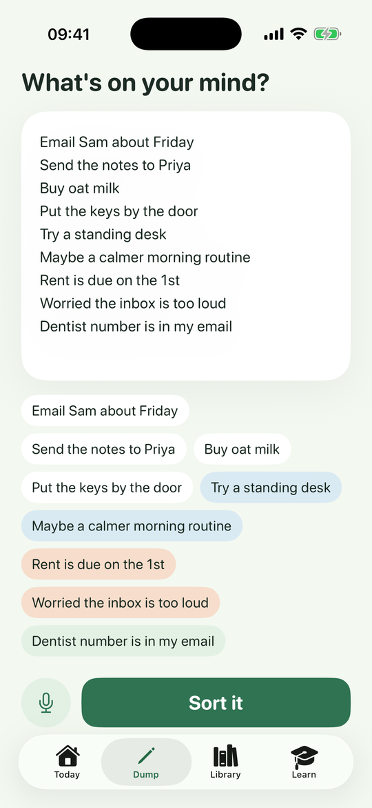 <em>In Brain dump you type everything on your mind, one thought per line.</em></td>
</tr>
<tr>
<td width="33%" align="center">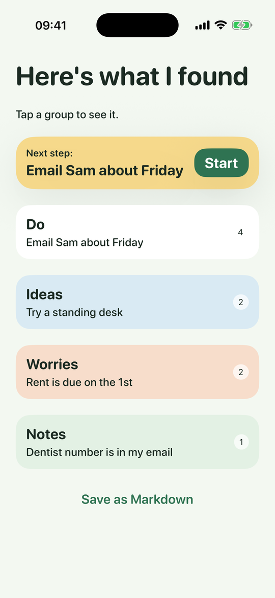 <em>Neuply sorts each line into Do, Ideas, Worries and Notes and picks one next step.</em></td>
<td width="33%" align="center">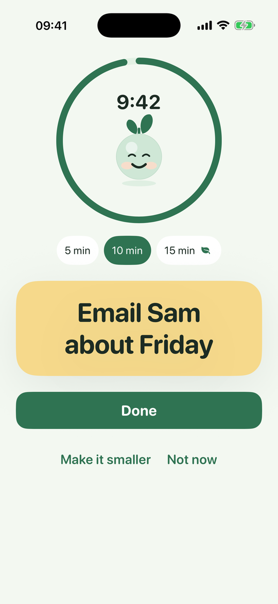 <em>The focus screen shows one step in big type with a 5, 10 or 15 minute ring timer.</em></td>
<td width="33%" align="center">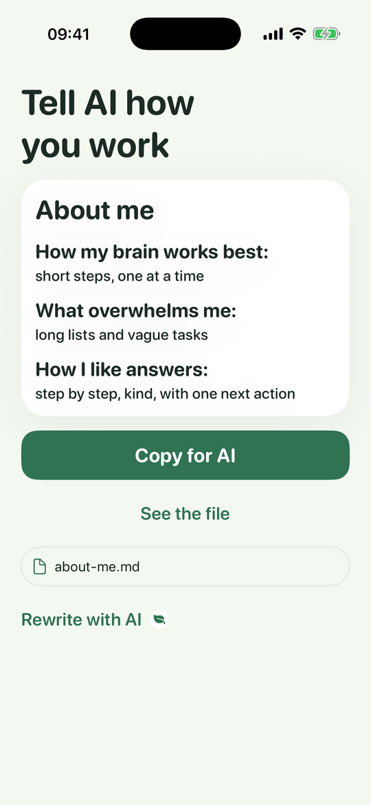 <em>Context maker writes an about-me file you can paste into any AI chat.</em></td>
</tr>
<tr>
<td width="33%" align="center">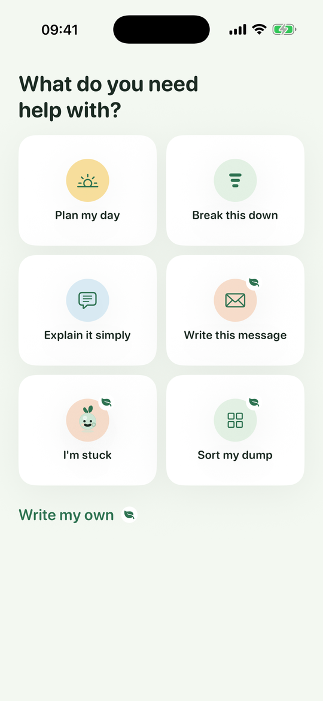 <em>Prompt helper offers six starting points, like Plan my day and I'm stuck.</em></td>
<td width="33%" align="center">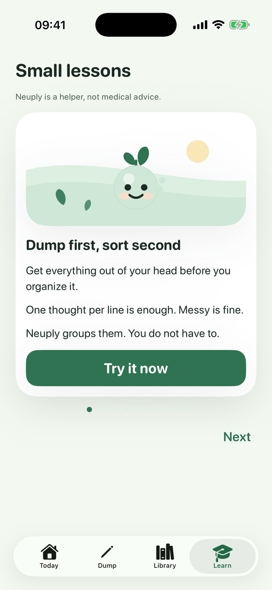 <em>Small lessons teach calm habits for using AI and say plainly that they are not medical advice.</em></td>
<td width="33%" align="center">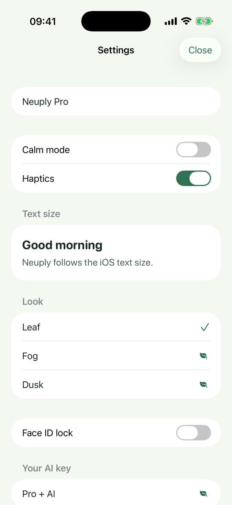 <em>Settings has Calm mode, haptics, text size, three looks and a Face ID lock switch.</em></td>
</tr>
<tr>
<td width="33%" align="center">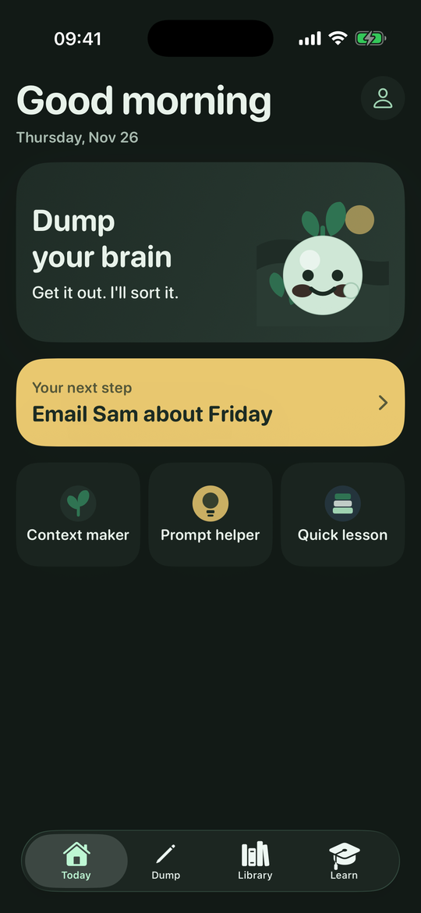 <em>Dark mode keeps the same layout on a dark background.</em></td>
<td width="33%" align="center">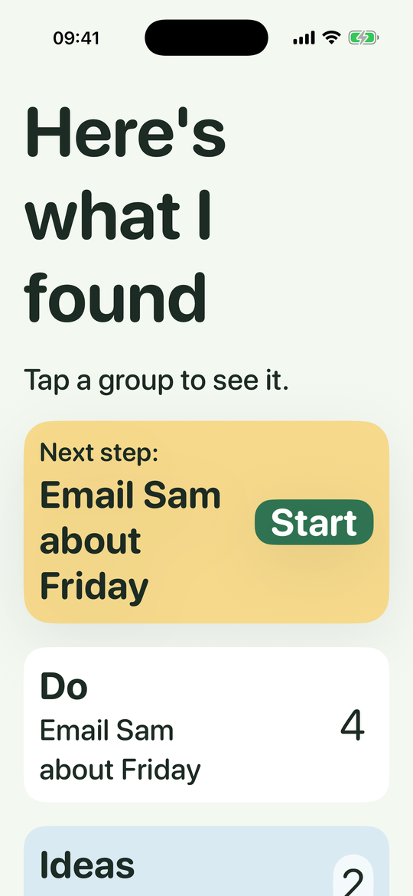 <em>The sorted screen at the largest text size stays readable.</em></td>
<td></td>
</tr>
</table>

## What's in it

| Piece | What it does |
|---|---|
| **Brain dump** | Sorts typed thoughts into Do, Ideas, Worries and Notes. You can save the result as a Markdown file. |
| **One next step** | Picks the smallest concrete task and offers Done, Make it smaller and Not now. |
| **Focus ring** | A quiet 5, 10 or 15 minute timer with Pip inside. |
| **Context maker** | Seven short questions you can skip. It writes an about-me file for any AI chat. |
| **Prompt helper** | Six starting prompts. It adds your about-me file on top when you switch that on. |
| **Small lessons** | Short cards on habits that help an ADHD brain use AI. |
| **Accounts** | Sign up and sign in on the phone. The app stores a hash and never the password itself. Apple and Google sign-in say "Coming soon." |
| **Pro screen** | Shows Free, Pro and AI tiers. A test checks that closing it buys nothing. |

## How I built it

1. **A small web version first.** I built an offline web app with four tools: Brain dump, Context maker, Prompt helper and Learn. Its 12 automated tests pass.
2. **A mockup.** I wrote a design brief and had an AI image tool make one mockup for the look. I approved it before I moved on.
3. **The iPhone app.** AI coding helpers wrote the SwiftUI code under my direction. I reviewed it and tested it. The Xcode project builds and runs in Codemagic, a cloud service with Mac machines, using Xcode 26.6 on an iPhone simulator. I treat compiler warnings as errors.
4. **Tap through and fix.** My first draft looked plain with thin text. After tapping through, I asked for bigger and bolder type, centered onboarding, an illustrated Pip, the tools in one row and real on-device sign-in.

A Figma file with a clickable prototype also exists.
<!-- TODO (Manny): add the Figma prototype link once sharing is on. -->

## What I built and why it matters

- I built a native SwiftUI iPhone app and backed it with 33 automated tests, 27 unit tests and 6 tap-through tests. All 33 passed in the cloud simulator on build 15. At least five earlier cloud builds had failed and I fixed each one.
- I made the app calm and private on purpose. Everything stays on the phone. I captured the screens in light mode, dark mode and at the largest text size, and a test checks that text colors stay readable.

## Skills Learned and Used

| Product and design | Engineering |
|---|---|
| UX for ADHD and neurodivergent users | SwiftUI and Xcode |
| Accessibility: contrast, large text, dark mode | Unit and UI testing with XCTest |
| Privacy by design | Cloud builds with Codemagic |
| Figma prototyping | Directing and reviewing AI coding helpers |

## What this proves and what it doesn't

- **What it proves.** I can take an idea from research to a mockup to a tested iPhone app, with accessibility and privacy built in.
- **What it doesn't prove.** The AI rewrite is a stand-in that gives the same answer each time, and a test checks that. Neuply has been tested only in the simulator, not on a real phone. No real users have tried it yet. It is a helper, not a medical tool.
- **Public version.** The source code is not in this repo. The screenshots come from the simulator and show only sample text.
<!-- TODO (Manny): decide if the Neuply source code should be published, and add real user feedback if any. -->
