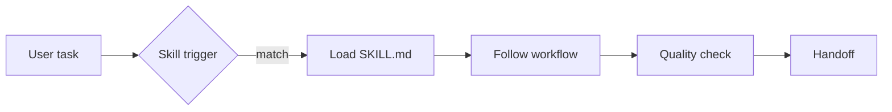

# AI Agent Skills

**Emanuel Walker, AI cybersecurity builder**

A skill is a small instruction package that teaches an AI agent one repeatable job.

Instead of rewriting one giant prompt every time, this project turns repeated work into scoped skills with triggers, boundaries, output contracts, and handoff checks.



## Skill library

Each skill lives in `skills/<name>/SKILL.md`.

This library is a set of reusable instruction modules I wrote for coding agents.

### Writing and voice

| Skill | What it does |
|---|---|
| [article-writing](skills/article-writing/SKILL.md) | Write long-form essays, guides, and posts in a distinctive voice. |
| [brand-voice](skills/brand-voice/SKILL.md) | Build a reusable voice profile from your own writing samples. |
| [content-engine](skills/content-engine/SKILL.md) | Draft platform-native content from a seed bank. Never auto-publishes. |
| [humanizer](skills/humanizer/SKILL.md) | Remove common AI-writing tells and make the text more direct. |
| [prompt-optimizer](skills/prompt-optimizer/SKILL.md) | Diagnose a raw prompt and rewrite it as a clear, ready-to-paste version. |
| [voice-and-post-desk](skills/voice-and-post-desk/SKILL.md) | Build a voice profile, edit a draft, or prepare an approved social post. |
| [write-like-you-getting-started](skills/write-like-you-getting-started/SKILL.md) | Set up a Write Like You voice profile and edit drafts to match it. |

### Building and shipping

| Skill | What it does |
|---|---|
| [builder-walkthrough](skills/builder-walkthrough/SKILL.md) | Turn a technical project into a beginner build guide with checkpoints. |
| [docs-readability-audit](skills/docs-readability-audit/SKILL.md) | Review technical docs for plain English and followability. |
| [drawio](skills/drawio/SKILL.md) | Create and edit draw.io diagrams in XML. |
| [file-organizer](skills/file-organizer/SKILL.md) | Organize files, find duplicates, and propose a cleanup structure. |
| [plain-english-code](skills/plain-english-code/SKILL.md) | Write clear code with short functions and comments that explain why. |
| [product-build-and-release](skills/product-build-and-release/SKILL.md) | Build or audit a PDF, workbook, skill, or ZIP before release. |
| [repo-onboarding-audit](skills/repo-onboarding-audit/SKILL.md) | Audit a repository so a new person or agent can build and change it safely. |
| [ship-learn-next](skills/ship-learn-next/SKILL.md) | Turn lectures and tutorials into concrete practice reps. |
| [startup-product-playbook](skills/startup-product-playbook/SKILL.md) | Help a startup with product decisions, writing, secure builds, and launch, without inventing proof. |
| [verified-visual-production](skills/verified-visual-production/SKILL.md) | Place or produce images that match the real source, then inspect every asset. |
| [web-ui-audit](skills/web-ui-audit/SKILL.md) | Review a site for accessibility, mobile use, navigation, and clarity. |

### Second brain and research

| Skill | What it does |
|---|---|
| [briefing-and-edition](skills/briefing-and-edition/SKILL.md) | Build a morning brief or personal newspaper from approved mail, calendar, and news. |
| [companion-context](skills/companion-context/SKILL.md) | Design a personal companion agent with separate memory, tools, and interface layers. |
| [evidence-to-experiment](skills/evidence-to-experiment/SKILL.md) | Turn researched evidence into a decision or one small test. |
| [obsidian](skills/obsidian/SKILL.md) | Automate an Obsidian vault with file operations and URI control. |
| [second-brain-starter-getting-started](skills/second-brain-starter-getting-started/SKILL.md) | Guide a new owner through first-time Second Brain Starter setup. |
| [smart-ocr](skills/smart-ocr/SKILL.md) | Extract text from images, scans, and photos with local OCR. |
| [source-to-study-pack](skills/source-to-study-pack/SKILL.md) | Convert approved documents and scans into searchable notes with source links. |
| [statement-reconciliation-report](skills/statement-reconciliation-report/SKILL.md) | Reconcile bank or payment statements into a verified workbook and PDF. |
| [vault-companion](skills/vault-companion/SKILL.md) | Review notes, prepare a companion context pack, and close a vault session. |

### Security and delivery

| Skill | What it does |
|---|---|
| [bounded-team-delivery](skills/bounded-team-delivery/SKILL.md) | Coordinate agents on a shared task with clear scope, ownership, and stopping rules. |
| [bug-bounty-hunter](skills/bug-bounty-hunter/SKILL.md) | Plan legal bug bounty or VDP work from written scope, then draft a careful report. |
| [mcp-and-plugin-integration-proof](skills/mcp-and-plugin-integration-proof/SKILL.md) | Prove an MCP, plugin, or connector works end to end, layer by layer. |
| [packet-capture-analyst](skills/packet-capture-analyst/SKILL.md) | Give exact Wireshark filters and clicks to answer a question about a PCAP. |
| [single-question-security-check](skills/single-question-security-check/SKILL.md) | Ask one clear question about an unexpected sign-in, password, or payment alert. |

This folder publishes reusable public skills I wrote. Private workflows and third-party packs are not included as original work. Earlier inspiration notes live in [`skills/THIRD_PARTY_ATTRIBUTION.md`](skills/THIRD_PARTY_ATTRIBUTION.md).

## Resume starter

> Built a reusable library of agent skills that turns repeated work into scoped, testable instruction modules with clear triggers, boundaries, and output contracts.

Adapt it after you install, test, or build your own skill.

---

# Build it from zero

## What you will learn

A skill is a folder that teaches an AI agent how to perform one repeatable job.

The important file is:

```text
SKILL.md
```

A good skill tells the agent:

- what the skill does
- when to use it
- when not to use it
- what steps to follow
- what a good result looks like
- what to check before handoff

By the end, you will:

- install Codex or Claude Code
- download the skill library
- run the Humanizer skill explicitly
- optionally install a skill into your agent setup
- install a starter pack
- create your own tiny skill
- test whether the skill actually changes agent behavior

You do not need Git.

---

# Part 1. Choose one coding agent

Pick one.

## Option A. Codex

Use this if you already use ChatGPT/OpenAI.

## Option B. Claude Code

Use this if you already use Claude/Anthropic.

Do not install both just to complete this walkthrough.

---

# Part 2A. Install Codex

## Step 1A. Create or confirm your ChatGPT account

Open:

```text
https://chatgpt.com
```

Sign in.

## Step 2A. Install Node.js

Google:

```text
Node.js LTS
```

Use:

```text
https://nodejs.org/
```

Install the current LTS release.

Close and reopen your terminal.

Check:

### Windows PowerShell

```powershell
node --version
npm --version
```

### macOS Terminal

```bash
node --version
npm --version
```

## Step 3A. Install Codex

```bash
npm install -g @openai/codex@latest
codex --version
```

On Windows, if PowerShell blocks `npm`, try:

```powershell
npm.cmd install -g @openai/codex@latest
codex --version
```

**PASS:** Codex prints a version.

---

# Part 2B. Install Claude Code

Claude Code's recommended path is the native installer.

You do not need Node.js for the recommended native installation.

## macOS

Open Terminal.

Run:

```bash
curl -fsSL https://claude.ai/install.sh | bash
```

Then verify:

```bash
claude --version
claude doctor
```

## Windows PowerShell

Open PowerShell.

Run:

```powershell
irm https://claude.ai/install.ps1 | iex
```

Open a new PowerShell window.

Verify:

```powershell
claude --version
claude doctor
```

You do not need Administrator privileges for the normal native install.

### Windows alternative

If you already use WinGet:

```powershell
winget install Anthropic.ClaudeCode
claude --version
```

Git for Windows is optional.

WSL 2 is optional if you specifically want a Linux toolchain or sandboxing.

**PASS:** Claude Code prints a version and `claude doctor` reports no blocking install problem.

# Part 3. Get the skill library

## Beginner method

Open:

```text
https://github.com/Emanuel-Walker/cyber-portfolio
```

Choose:

```text
Code -> Download ZIP
```

Extract it.

Open:

```text
cyber-portfolio-main/05-ai-agent-skills
```

## Developer method

Optional:

```bash
git clone https://github.com/Emanuel-Walker/cyber-portfolio.git
cd cyber-portfolio/05-ai-agent-skills
```

---

# Part 4. Open a terminal in the skill project

## Windows

Open the `05-ai-agent-skills` folder.

Click the File Explorer address bar.

Type:

```text
powershell
```

Press Enter.

## macOS

Open Terminal.

Type:

```bash
cd 
```

Drag the folder into Terminal.

Press Enter.

**PASS:** the terminal is inside `05-ai-agent-skills`.

---

# Part 5. Inspect one skill before using it

Open:

```text
skills/humanizer/SKILL.md
```

Look at the front matter.

You should see fields similar to:

```yaml
---
name: humanizer
description: ...
---
```

Then read the instructions.

This is important.

Do not install random public skills without reading them first.

Skills can contain:
- instructions
- scripts
- references
- templates
- assets

Treat them like code.

---

# Part 6. Run the skill explicitly

This is the most reliable first test.

Launch your agent from the `05-ai-agent-skills` folder.

## Codex

```bash
codex
```

## Claude Code

```bash
claude
```

Then paste:

```text
Read:

skills/humanizer/SKILL.md

Use that skill strictly on this paragraph:

"In today's rapidly evolving threat landscape, organizations must leverage robust, scalable solutions to seamlessly integrate advanced detection capabilities. Moreover, by utilizing cutting-edge AI, security teams can delve into unprecedented insights that empower proactive defense."

Return:
1. the rewritten paragraph
2. five specific skill rules you applied
```

Expected behavior:

The rewrite should remove or reduce words such as:

```text
leverage
robust
seamlessly
utilizing
delve
moreover
```

It should also become shorter and more direct.

**PASS:** the output clearly reflects rules from the skill file.

This proves the skill itself works before you worry about automatic discovery.

---

# Part 7. Install one skill

This repo includes helper scripts.

## macOS / Linux

For Codex:

```bash
bash scripts/install-skill.sh codex humanizer
```

For Claude Code:

```bash
bash scripts/install-skill.sh claude humanizer
```

## Windows PowerShell

Codex:

```powershell
.\scripts\install-skill.ps1 -Agent codex -Item humanizer
```

Claude:

```powershell
.\scripts\install-skill.ps1 -Agent claude -Item humanizer
```

The installer refuses to silently overwrite an existing skill folder.

**PASS:** it prints:

```text
PASS: install complete.
```

---

# Part 8. Verify the installed files

## Codex example

Check:

```text
~/.codex/skills/humanizer/SKILL.md
```

## Claude example

Check:

```text
~/.claude/skills/humanizer/SKILL.md
```

On Windows, `~` means your user home directory.

If your current agent version uses a different skills/plugin mechanism, the explicit-read workflow from Part 6 still works.

Do not confuse:

```text
the skill file is valid
```

with:

```text
my exact agent build auto-discovers this folder
```

Those are separate questions.

---

# Part 9. Install a starter pack

The project includes four packs.

## Builder pack

```text
repo-onboarding-audit
builder-walkthrough
web-ui-audit
prompt-optimizer
plain-english-code
product-build-and-release
```

Install:

```bash
bash scripts/install-skill.sh codex builder-pack
```

or:

```powershell
.\scripts\install-skill.ps1 -Agent codex -Item builder-pack
```

## Writing pack

Includes writing and voice skills, including Humanizer and voice-and-post-desk.

## Second Brain pack

Includes:
- Obsidian workflow skill
- companion-context skill
- file organizer
- docs readability audit
- vault-companion
- source-to-study-pack

## Security pack

Includes:
- bug-bounty-hunter
- packet-capture-analyst
- single-question-security-check
- mcp-and-plugin-integration-proof

Install:

```bash
bash scripts/install-skill.sh claude security-pack
```

Do not install every skill just because it exists.

Install what you will actually use.

---

# Part 10. Build your first skill

Create:

```text
skills/my-first-skill/
```

Inside it create:

```text
SKILL.md
```

Paste:

```markdown
---
name: next-action
description: Use when the user has too many tasks and needs one concrete next action.
---

# Next Action

Use this skill when the user gives you a messy task list or says they are stuck.

1. Identify the single outcome that matters most.
2. Choose one action that can be completed in 20 minutes or less.
3. Return only:
   - Next action
   - Why this one
   - Definition of done

Do not create a full productivity system.

Before handoff, confirm the action is concrete and physically doable.
```

Save it.

---

# Part 11. Test your new skill

In Codex or Claude Code:

```text
Read:

skills/my-first-skill/SKILL.md

Use it on this list:

- clean up my portfolio
- study AWS
- reply to emails
- reorganize all my notes
- update one broken project walkthrough
```

Expected shape:

```text
Next action:
...

Why this one:
...

Definition of done:
...
```

**PASS:** the agent chooses one action instead of giving you another giant list.

---

# Part 12. Improve the skill

Ask:

```text
Audit skills/my-first-skill/SKILL.md.

Tell me:
1. when the trigger is too vague
2. where the instructions could conflict
3. one test case that should invoke it
4. one test case that should NOT invoke it

Do not edit the file yet.
```

That is skill engineering.

The hard part is not writing Markdown.

The hard part is making the instructions:
- narrow
- discoverable
- testable
- safe
- reusable

---

# Common problems

## Agent ignores the skill

Use the explicit form:

```text
Read path/to/SKILL.md and use it strictly.
```

Then diagnose discovery separately.

## Installer says the folder already exists

That is intentional.

Read the existing installed skill first.

Remove or update it deliberately.

## Skill triggers too often

Tighten the `description` front matter.

The description should explain:
- what the skill does
- when it should be considered

## Skill produces inconsistent output

Add an output contract.

Example:

```text
Return exactly:
1. Finding
2. Evidence
3. Fix
```

---

# Definition of done

- [ ] Codex or Claude Code installed
- [ ] skill library downloaded
- [ ] Humanizer skill inspected
- [ ] Humanizer explicitly tested
- [ ] one skill installed
- [ ] starter pack understood
- [ ] your own SKILL.md created
- [ ] custom skill tested
- [ ] trigger/boundary audit completed

You now understand the skill system well enough to build your own reusable agent workflows.

---

## What this project proves

A reusable agent workflow can be treated like an engineering artifact with a clear trigger, narrow scope, expected output, and handoff checks.

A skill does not make an AI model automatically correct. Human review still matters.

## Key artifacts

- `skills/<name>/SKILL.md` = the actual reusable skill
- `scripts/` = optional installers
- `skills/THIRD_PARTY_ATTRIBUTION.md` = upstream inspiration and licensing notes
