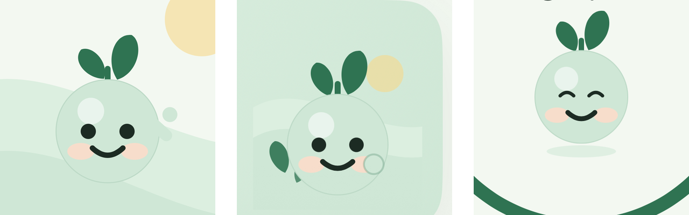
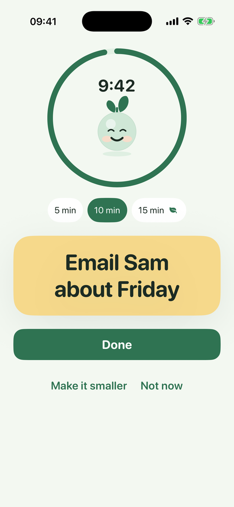
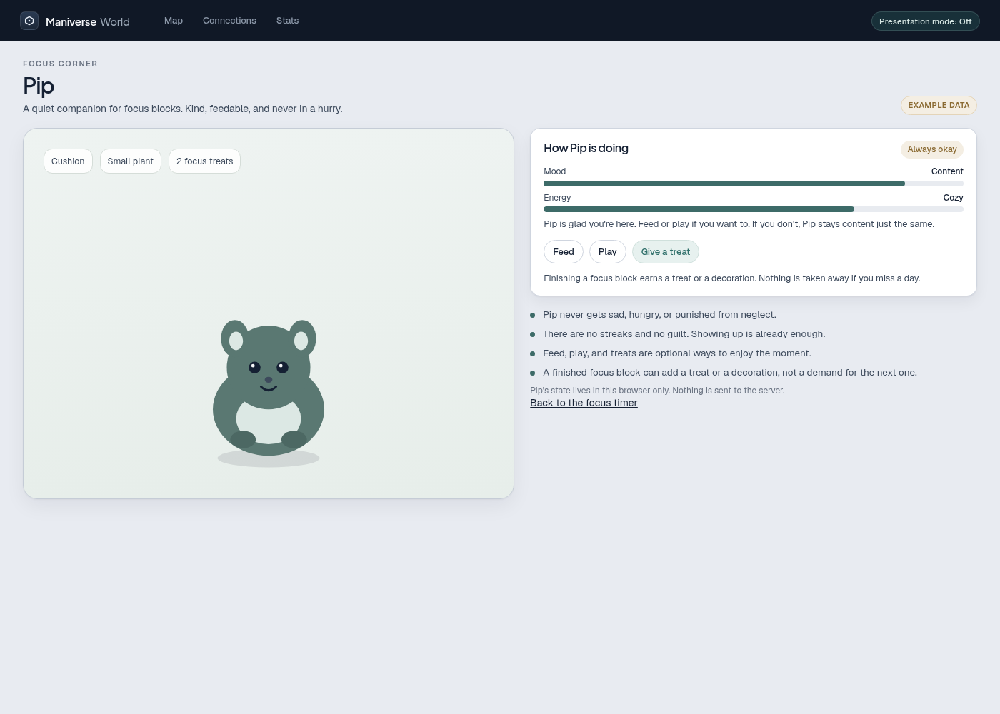

# Pip: A Focus Pet That Never Guilts You

**Emanuel Walker, AI cybersecurity builder**
Character Design · UX for ADHD · Focus Tools

> **Status.** Pip lives in two places. The seed mascot is in my Neuply iPhone prototype and has been captured in the simulator. The pet page is a preview in my private Maniverse World site. It uses example data and is not live yet.

## The short version

Pip is a small friendly character I designed for people who lose focus and then feel bad about it. Pip keeps you company while you work on one small step. Pip never nags, never gets sad and never punishes you for missing a day.

There are two Pips:

- **The Neuply seed.** A round seed with two leaves and rosy cheeks. It says hello, thinks along with you and rests inside the focus timer.
- **The Maniverse pet.** A cozy round pet on my private Maniverse World page. You can feed it, play with it or give it a treat. Pip stays content either way.

*Left to right, Pip says hello on the first screen, looks thoughtful on the Today card and rests with closed eyes inside the focus timer.*

## Why I built it

Many focus apps use streaks, points and red warnings. For a brain that already feels behind, those turn into guilt, and guilt makes people quit. I wanted a companion that feels like a calm friend in the room.

## The design rules

- Pip never gets sad, hungry or punished for neglect.
- There are no streaks and no guilt. Showing up is already enough.
- Feeding, playing and treats are optional ways to enjoy the moment.
- Pip never talks over your content and never asks for money.
- Pip's state stays on your own device. The Maniverse page says that Pip's state lives in the browser only.

## Pip in Neuply

I wrote down Pip's look so every screen matches. The design brief names the shape, the colors and four moods: hello, thinking, cheer and resting. Pip shows up on the hello screen, the Today card and the focus timer, where one step sits in big type below Pip.

*On the focus timer Pip rests inside a ring while you work on one step.*

## Pip on Maniverse World

The Maniverse pet is a different character with the same name and the same rules. The page shows two calm bars, Mood and Energy, with a note that Pip is always okay. The three buttons are optional. The page says finishing a focus block can add a treat or a decoration, and that nothing is taken away if you miss a day.

*The Pip page in my Maniverse World preview has Feed, Play and Give a treat buttons and an example data label.*

This page is part of the new Maniverse World site. I built it in a private test copy and have not made it live. Everything on it is example data for now.
<!-- TODO (Manny): add real usage or feedback after Pip goes live, and note how treats behave over several days. -->

## What I built and why it matters

- I designed one friendly character with written rules and used it in 2 products, the Neuply iPhone app and the Maniverse World page. Pip's look stays the same across 3 captured Neuply screens.
- I wrote the no-guilt rules into the design. Pip has 3 optional actions, Feed, Play and Give a treat. It has no streaks and no penalties for missing a day.

## Skills Learned and Used

| Design | Product |
|---|---|
| Character and mascot design | UX for ADHD and neurodivergent users |
| Design briefs and style rules | Focus and habit tool design |
| Accessible, calm interfaces | Directing AI coding helpers |
| Consistent look across products | Prototyping in SwiftUI and HTML |

## What this proves and what it doesn't

- **What it proves.** I can design a character with clear rules and carry it across products.
- **What it doesn't prove.** Pip has no real users yet. The Maniverse pet page is a preview with example data, and I have not tested how it behaves over days. Pip does not claim to treat ADHD or any health condition.
- **Public version.** The code for both Pips is not in this repo. The screenshots show only example data.
