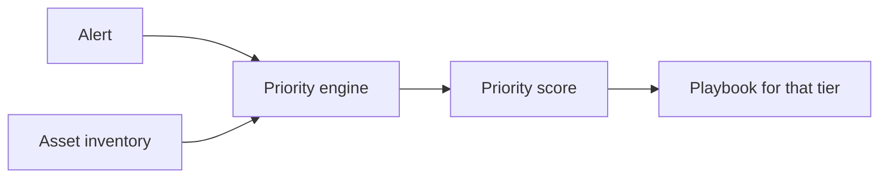

# Crown Jewel Triage

**Emanuel Walker, AI cybersecurity builder**
SOC Strategy · Risk Prioritization · Python

## The short version

Most alert queues sort by one thing: how severe the alert says it is. That misses a bigger question. How much does the thing under attack matter to the business?

This project adds that missing piece. It scores each asset on four factors, groups assets into six tiers, and multiplies the alert's severity by the tier. The result is a ranked queue with a response playbook attached to every alert.



*An alert and the asset it hit go in, and a ranked queue with a playbook comes out.*

## What the sample run shows

I ran six made-up alerts against a made-up inventory of 12 assets. The two "high" severity alerts landed near the bottom. A "medium" alert on the payment system landed on top.

| Rank | Priority | Alert severity | Asset | Why |
|---|---:|---|---|---|
| 1 | 40.0 | medium | Payment settlement server | Tier 1, the top tier, so 4 × 10 |
| 2 | 24.0 | medium | Single sign-on tenant | Tier 2, so 4 × 6 |
| 3 | 10.0 | low | Build server | Tier 3, so 2 × 5 |
| 4 | 7.0 | high | Marketing laptop | Tier 6, so 7 × 1 |
| 5 | 7.0 | high | Dev sandbox cluster | Tier 6, so 7 × 1 |
| 6 | 1.0 | informational | Honeypot | Tier 6, so 1 × 1 |

*Same alerts, ranked by what they threaten instead of by severity alone.*

## How the score works

Each asset gets 1 to 5 points on four factors:

- **Business impact.** What breaks if it is down for 4 hours?
- **Data sensitivity.** How private is the data on it?
- **Blast radius.** How far can an attacker go from it?
- **Recovery cost.** What does it take to rebuild it?

The four points add up to a number from 4 to 20. That number picks the tier:

| Tier | Points | What it covers |
|---|---|---|
| 1 | 18 to 20 | Crown jewels |
| 2 | 15 to 17 | High-trust identity systems |
| 3 | 15 to 17 | Build and deploy systems |
| 4 | 11 to 14 | SaaS data paths |
| 5 | 8 to 10 | Stepping stones like jump hosts and VPNs |
| 6 | 4 to 7 | Noise |

Priority is the alert's severity points times the tier multiplier. Severity points run from 10 for critical down to 1 for informational. Tier multipliers run from 10 for tier 1 down to 1 for tier 6. The full rubric, with examples for each score, is in `code/models/scoring_rubric.yaml`. It is plain YAML so a non-programmer can read it.

## What's in the folder

| Path | What it is |
|---|---|
| `code/crown_jewel_scorer.py` | Scores alerts and prints ranked JSON. |
| `code/run_prioritization.py` | Builds the ranked queue as a Markdown table. |
| `code/example_asset_inventory.yaml` | 12 made-up assets with their four scores. |
| `code/example_alerts.jsonl` | 6 made-up alerts. |
| `code/models/` | The scoring rubric and the asset schema. |
| `playbooks/` | A tier definitions file and one response playbook for each of the 6 tiers. |
| `examples/queue.sample.md` | A saved copy of the queue the tool produces. |
| `dashboards/` | A Grafana dashboard file with 5 panels and notes on each panel. I have not tested it against live data. |
| `diagrams/` | Two diagrams in `.drawio` format. Open them in diagrams.net. |

## Run it

You need Python 3.10 or newer and one package, PyYAML. Git is optional.

```bash
cd 08-crown-jewel-triage
python3 -m venv .venv
source .venv/bin/activate        # Windows: .\.venv\Scripts\Activate.ps1
python -m pip install pyyaml
python code/crown_jewel_scorer.py --inventory code/example_asset_inventory.yaml --alerts code/example_alerts.jsonl
python code/run_prioritization.py --inventory code/example_asset_inventory.yaml --alerts code/example_alerts.jsonl --out queue.md
```

The first command prints the ranked results. The second writes `queue.md`. On Nov 28, 2026, both ran cleanly and the queue matched the table above.

## Try changing it

Open `code/example_asset_inventory.yaml`. Pick the marketing laptop and raise its `business_impact` from 1 to 3. Run the queue command again. When I tried it, the laptop moved from tier 6 to tier 5. Its priority went from 7.0 to 14.0 and its rank went from 4 to 3. Undo the edit when you finish.

## What I built and why it matters

- I built a scoring model that ranks alerts by what they threaten. In the sample run, a medium alert on the payment system ranks above two high alerts on a laptop and a sandbox.
- I wrote 6 playbooks, one for each tier, so the queue says what to do next and not only what to look at first.

## Skills Learned and Used

| Security | Software |
|---|---|
| SOC strategy and alert triage | Python |
| Risk scoring and asset tiering | YAML data models |
| Incident response playbooks | Grafana dashboards |
| Business impact analysis | Technical writing |

## What this proves and what it doesn't

- **What it proves.** You can turn business context into a clear, explainable ranking.
- **What it doesn't prove.** The inventory and alerts are made up. A real company would need system owners to check every score. A number from Python is not automatically objective, and the model is only as good as the inventory behind it.
