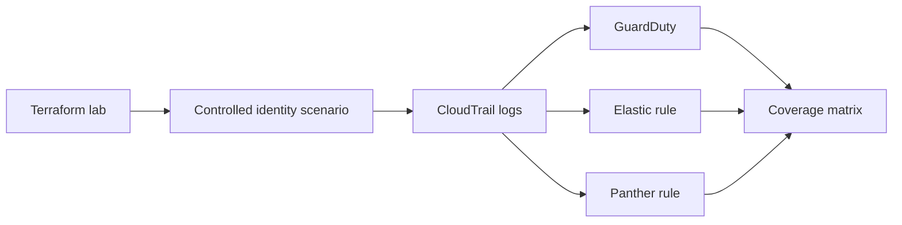

# Identity-First AWS Incident Response Lab

**Emanuel Walker, AI cybersecurity builder**
Cloud Security · AWS · Detection Engineering

## The short version

Many cloud break-ins do not use malware. The attacker logs in with a stolen key, then makes normal-looking API calls. The cloud's built-in alarms often stay quiet.

This project has two parts:

- **A free offline demo.** It runs one custom detection on two made-up events. You need no AWS account.
- **An optional AWS lab.** Terraform builds a small lab. Five scripts act out identity attacks inside it. You then compare what AWS GuardDuty caught with what custom rules caught.



*Each scenario writes CloudTrail logs, and the matrix records which tool caught it.*

## Why it matters

GuardDuty needs a baseline of normal behavior before it flags odd behavior. A fresh account has none. A rule you write yourself can catch a specific risky action on day one. This lab is a way to see that gap for yourself.

## The five scenarios

| # | Scenario | What the script does |
|---|---|---|
| 01 | OAuth token theft | Reads a fake refresh token from AWS Systems Manager, makes an access key, then lists users from outside its normal scope. |
| 02 | Privilege escalation by a non-human identity | Assumes an over-powered role, looks up a lab secret, then assumes a second role. |
| 03 | Odd session | Assumes a role with an unusual browser signature and lists resources. |
| 04 | Data pull | Reads 20 fake customer files 10 times each, which makes 200 reads. |
| 05 | Quiet IAM changes | Makes an access key, attaches a read-only policy and checks the password policy. It cleans up after itself. |

Scenario 05 attaches the read-only policy `ReadOnlyAccess` as a safe stand-in for a dangerous admin policy. The detection logic covers both.

## What's in the folder

| Path | What it is |
|---|---|
| `terraform/` | The lab in Terraform, including a VPC, one server, S3 buckets, IAM roles, CloudTrail and GuardDuty. `teardown.sh` removes it. |
| `attacks/` | The five scenarios, each with a `run.sh`. Also a safety check that stops them from running in any account without the lab's tag. |
| `detections/` | Five Elastic rules, five Panther rules, five CloudTrail search queries and the coverage matrix. |
| `detections/demo_iam_detection.py` | The offline demo. |
| `tabletop/` | A 90 minute team exercise about an attacker who takes over a cloud account. It is a discussion guide and has no code. |
| `diagrams/` | Three diagrams in `.drawio` format. Open them in diagrams.net. |

## Run the offline demo

You need Python 3.10 or newer. No packages to install.

```bash
cd 09-identity-cloud-ir
python3 detections/demo_iam_detection.py attacks/demo_events/create_access_key.json
python3 detections/demo_iam_detection.py attacks/demo_events/list_buckets.json
```

On Windows, use `py` in place of `python3`.

The first command prints `MATCH: IAM persistence / privilege-change detection`. The second prints `NO MATCH`. I ran both on Nov 28, 2026 and got those results.

This demo is a small Python copy of the main conditions in `detections/elastic_detection_rules/iam_access_key_creation.yml`. It is not a full Elastic engine.

## Run the AWS lab (optional, costs money)

This creates real AWS resources. GuardDuty and CloudTrail can cost a few dollars a day if you forget to turn them off. Use a separate account that holds nothing important.

1. Secure the account. Turn on MFA for the root user and set a budget alert. Then create a non-root user for the command line.
2. Install the AWS CLI and Terraform 1.5 or newer. Check your account with `aws sts get-caller-identity`.
3. Copy `terraform/terraform.tfvars.example` to `terraform/terraform.tfvars`. Put in your own email and your own IP address as a `/32`. Never commit this file.
4. Build the lab. Read the plan before you approve it.

```bash
terraform -chdir=terraform init
terraform -chdir=terraform validate
terraform -chdir=terraform plan
terraform -chdir=terraform apply
```

5. Install `boto3` with `python -m pip install boto3`. Then run a scenario:

```bash
cd attacks/01-oauth-token-theft
./run.sh
```

6. Tear it down when you finish, then check the AWS console for leftovers.

```bash
./terraform/teardown.sh
```

`teardown.sh` runs `terraform destroy -auto-approve`, so it does not ask before it deletes everything Terraform created. It then lists any S3 buckets, parameters or GuardDuty detectors that lingered.

## What the coverage matrix says

`detections/detection_matrix.md` lists how each tool did on the five scenarios:

| Tool | Result |
|---|---|
| GuardDuty default | 0 clean catches, 1 partial |
| GuardDuty with every protection plan | 0 clean catches, 3 partials |
| Custom Athena queries | 5 of 5 |
| Custom Elastic rules | 5 of 5 |
| Custom Panther rules | 5 of 5 |

The matrix also explains why GuardDuty missed things. Its anomaly findings need 7 to 14 days of baseline, and a fresh lab account has none.

**Read this before you quote the matrix.** The folder has no saved CloudTrail logs, screenshots or Terraform output from a live run. The matrix is the project's recorded result. It is not proof. Only the offline demo has a result you can check without an AWS account. The terraform files and the attack scripts were not run for this cleanup.
<!-- TODO (Manny): confirm whether the AWS lab was actually deployed and add proof such as screenshots or sample CloudTrail output. -->

## What I built and why it matters

- I wrote 5 identity attack scripts with a safety check, plus 5 Elastic rules, 5 Panther rules and 5 CloudTrail queries. Each rule is tied to one scenario.
- I built an offline demo that proves one rule fires on an access-key event and stays quiet on a normal bucket listing, with no AWS account needed.

## Skills Learned and Used

| Security | Cloud and software |
|---|---|
| AWS IAM and CloudTrail | Terraform |
| GuardDuty and detection gaps | Python and boto3 |
| Elastic and Panther detection rules | SQL (Athena queries) |
| Incident response tabletop exercises | Bash |

## What this proves and what it doesn't

- **What it proves.** You can write detections for identity attacks and read the log trail they leave.
- **What it doesn't prove.** The lab is small and uses fake secrets. The coverage matrix has no saved evidence yet, and a lab result is not a guarantee for a real company.
